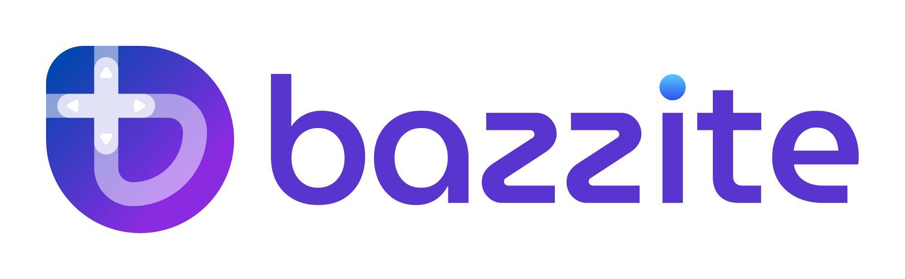

<p align="center" >
  <a href="https://bazzite.gg/" >
    <picture>
      <source srcset="repo_content/Bazzite_Light.svg" media="(prefers-color-scheme: dark)" >
      
    </picture>
  </a>
</p>

[](https://github.com/ublue-os/bazzite/actions/workflows/build.yml) [](https://github.com/ublue-os/bazzite/actions/workflows/build_iso.yml) [](https://scorecard.dev/viewer/?uri=github.com/ublue-os/bazzite) [](https://insights.linuxfoundation.org/project/ublue-os-bazzite) [](https://insights.linuxfoundation.org/project/ublue-os-bazzite) [](https://github.com/ublue-os/bazzite) [](https://deepwiki.com/ublue-os/bazzite)

# [🇺🇸](https://github.com/ublue-os/bazzite/blob/main/README.md) [🇪🇸](https://github.com/ublue-os/bazzite/blob/main/README-SPA.md) [🇮🇩](https://github.com/ublue-os/bazzite/blob/main/README-ID.md) [🇨🇳](https://github.com/ublue-os/bazzite/blob/main/README-zh-cn.md) [🇫🇷](https://github.com/ublue-os/bazzite/blob/main/README-FR.md) [🇧🇷](https://github.com/ublue-os/bazzite/blob/main/README-BR.md) [🇳🇱](https://github.com/ublue-os/bazzite/blob/main/README-NL.md) [🇷🇺](https://github.com/ublue-os/bazzite/blob/main/README-RU.md) [🇩🇪](https://github.com/ublue-os/bazzite/blob/main/README-DE.md) [🇸🇪](https://github.com/ublue-os/bazzite/blob/main/README-SV.md) [🇹🇼](https://github.com/ublue-os/bazzite/blob/main/README-ZH-TW.md) [🇹🇷](https://github.com/ublue-os/bazzite/blob/main/README-TR.md) [🇺🇦](https://github.com/ublue-os/bazzite/blob/main/README-UK.md)

<p align="center" >
  <a href="https://download.bazzite.gg/"></a>
</p>

---

# Зміст
- [🇺🇸 🇪🇸 🇮🇩 🇨🇳 🇫🇷 🇧🇷 🇳🇱 🇷🇺 🇩🇪 🇸🇪 🇹🇼 🇹🇷 🇺🇦](#------------)
- [Зміст](#зміст)
  - [Про проєкт і можливості](#про-проєкт-і-можливості)
    - [Для настільних ПК](#для-настільних-пк)
    - [Steam Deck/ПК для домашнього кінотеатру (HTPC)](#steam-deckпк-для-домашнього-кінотеатру-htpc)
      - [Інші портативні пристрої](#інші-портативні-пристрої)
    - [GNOME](#gnome)
    - [Можливості з базових проєктів](#можливості-з-базових-проєктів)
      - [Universal Blue](#universal-blue)
      - [Можливості Fedora Linux (Kinoite і Silverblue)](#можливості-fedora-linux-kinoite-і-silverblue)
  - [Чому Bazzite?](#чому-bazzite)
  - [Знімки екрана](#знімки-екрана)
  - [Документація](#документація)
  - [Перевірка підпису](#перевірка-підпису)
  - [Secure Boot](#secure-boot)
  - [Статистика внесків](#статистика-внесків)
  - [Історія зірок](#історія-зірок)
  - [Особлива подяка](#особлива-подяка)
  - [Зберіть власний образ](#зберіть-власний-образ)
    - [Як підписати свої образи](#як-підписати-свої-образи)
  - [Долучайтеся до спільноти](#долучайтеся-до-спільноти)
---

## Про проєкт і можливості

[Відвідайте наш вебсайт](https://bazzite.gg/), щоб отримати зрозуміле для новачків пояснення, що таке Bazzite. У цьому README все описано детально.

[Bazzite](https://bazzite.gg/) — це спеціальний образ [Fedora Atomic](https://fedoraproject.org/atomic-desktops/), створений за технологіями [cloud native](https://universal-blue.org/#cloud-native), який приносить найкраще з ігор на Linux на **всі ваші пристрої, зокрема на вашу улюблену портативну консоль**.

Bazzite побудовано на основі [ublue-os/main](https://github.com/ublue-os/main) з використанням технологій [Fedora](https://fedoraproject.org/), тому він має розширену підтримку обладнання та вбудовані драйвери. Крім того, Bazzite додає такі можливості:

- Використовує [ядро OGC](https://www.github.com/OpenGamingCollective/linux).
- HDR і VRR доступні за замовчуванням.
- Повна підтримка апаратного декодування H264.
- Драйвер [xone](https://github.com/medusalix/xone) для контролерів Xbox.
- Розширена підтримка ігрових кермів завдяки кільком додатковим драйверам.
- Повна підтримка [DisplayLink](https://www.synaptics.com/products/displaylink-graphics).
- [vkBasalt](https://github.com/DadSchoorse/vkBasalt), [MangoHud](https://github.com/flightlessmango/Mangohud) і [OBS VkCapture](https://github.com/nowrep/obs-vkcapture) встановлені й доступні за замовчуванням.
- Містить [розширення оболонки ROM Properties Page](https://github.com/GerbilSoft/rom-properties).
- [Distrobox](https://github.com/89luca89/distrobox) встановлено заздалегідь.
- Автоматична служба `bees`, яка зменшує місце на диску, що його займає вміст префіксів Wine.
- Підтримка HDMI CEC.
- [Input Remapper](https://github.com/sezanzeb/input-remapper) встановлено заздалегідь і ввімкнено. <sub><sup>(У варіанті для Deck доступний, але вимкнений за замовчуванням; увімкнути його можна командою `ujust restore-input-remapper`)</sup></sub>
- [Bazzite Portal](https://github.com/ublue-os/yafti-gtk) дає змогу легко встановлювати численні застосунки та налаштування, зокрема [LACT](https://github.com/ilya-zlobintsev/LACT) та IDE через Brew. Крім того, він має зручні кнопки для оновлення, перебазування (rebase) і навіть скидання образу системи до початкового стану.
- [Waydroid](https://waydro.id/) встановлено заздалегідь для запуску Android-застосунків. Налаштуйте його за цим [коротким посібником](https://docs.bazzite.gg/Installing_and_Managing_Software/Waydroid_Setup_Guide/).
- Керуйте застосунками за допомогою [Flatseal](https://github.com/tchx84/Flatseal), [Warehouse](https://github.com/flattool/warehouse) і [Gear Lever](https://github.com/mijorus/gearlever).
- Вбудовані драйвери [OpenRazer](https://openrazer.github.io). Щоб почати ними користуватися, виберіть OpenRazer у Bazzite Portal або виконайте `ujust install-openrazer` у терміналі.
- Вбудовані правила udev для [OpenTabletDriver](https://opentabletdriver.net/); повний набір програм можна встановити через Bazzite Portal або командою `ujust install-opentabletdriver` у терміналі.
- [Webapp Manager](https://github.com/linuxmint/webapp-manager) дає змогу створювати застосунки з вебсайтів для різних браузерів, зокрема Firefox.

### Для настільних ПК

Основний варіант, доступний як `bazzite`, підходить для настільних комп'ютерів.

- Автоматичні оновлення ОС, Flatpak-застосунків тощо на базі [uupd](https://github.com/ublue-os/uupd).

> [!IMPORTANT]
> **ISO-образи можна завантажити з нашого [вебсайту](https://download.bazzite.gg), а корисний посібник зі встановлення — [тут](https://docs.bazzite.gg/General/Installation_Guide/).**

Перебазуйтеся (rebase) з наявної системи Fedora Atomic на цей образ, якщо вам потрібні **драйвери GPU з відкритим кодом**:
(Зверніть увагу: NVK, драйвер Mesa з відкритим кодом для відеокарт NVIDIA, на момент написання все ще схильний до помилок. Про будь-які проблеми з NVK [повідомляйте розробникам Mesa](https://docs.mesa3d.org/bugs.html), а не Ublue/Bazzite)

```bash
rpm-ostree rebase ostree-unverified-registry:ghcr.io/ublue-os/bazzite:stable
```

або для пристроїв з відеокартами Nvidia, якщо потрібні **пропрієтарні драйвери NVIDIA**:

```bash
rpm-ostree rebase ostree-unverified-registry:ghcr.io/ublue-os/bazzite-nvidia:stable
```

**Для користувачів з увімкненим Secure Boot:** перед перебазуванням виконайте інструкції з нашої [документації щодо Secure Boot](#secure-boot).

### Steam Deck/ПК для домашнього кінотеатру (HTPC)
Варіант, створений як альтернатива SteamOS на Steam Deck, а також для використання HTPC як консолі, доступний як `bazzite-deck`:

- Завантажується одразу в ігровий режим (Game mode), як і SteamOS.
- **Автоматичний `bees` значно зменшує розмір compatdata.**
- **Підтримка всіх мов, які підтримує Fedora.**
- **Використовує Wayland на робочому столі з [підтримкою Steam Input](https://github.com/Supreeeme/extest).**
- Містить портовані версії більшості пакетів SteamOS, зокрема драйверів, утиліт оновлення прошивки та керування вентиляторами.
- Пропатчена Mesa для правильного керування частотою кадрів з Gamescope.
- Містить патчі з [SteamOS BTRFS](https://gitlab.com/popsulfr/steamos-btrfs) для повної підтримки BTRFS на SD-картці за замовчуванням.
- Постачається з портованою версією [SDGyroDSU](https://github.com/kmicki/SteamDeckGyroDSU), увімкненою за замовчуванням.
- Під час встановлення можна вибрати [Decky Loader](https://github.com/SteamDeckHomebrew/decky-loader), [EmuDeck](https://www.emudeck.com/), [RetroDECK](https://retrodeck.net/) і [ProtonUp-Qt](https://davidotek.github.io/protonup-qt/), а також багато інших корисних пакетів.
- Власна система оновлень на базі [uupd](https://github.com/ublue-os/uupd) дає змогу оновлювати ОС, Flatpak-застосунки тощо прямо з інтерфейсу ігрового режиму.
- Вбудована підтримка подвійного завантаження з Windows, оскільки встановлений Fedora завантажувач GRUB залишається недоторканим.
- Оновлення щось зламало? Легко поверніться до попередньої версії Bazzite завдяки функції відкату `rpm-ostree`. Попередні образи можна навіть вибрати під час завантаження.
- Steam і Lutris встановлені в образі як накладені пакети (layered packages).
- Використовує ZRAM<sub><sup>(4 ГБ)</sup></sub> з алгоритмом стиснення LZ4 за замовчуванням.
- Планувальники процесора [LAVD](https://crates.io/crates/scx_lavd) і [BORE](https://github.com/firelzrd/bore-scheduler) для плавного й чуйного ігрового процесу.
- Планувальник введення-виведення Kyber, який запобігає «голодуванню» I/O під час встановлення ігор або фонового процесу `duperemove`.
- Застосовує параметри ядра SteamOS.
- Містить відкалібровані за кольором профілі дисплея для матових і глянцевих екранів Steam Deck.
- Вимкнені за замовчуванням функції для досвідчених користувачів, зокрема:
    - Служба безпечного андервольтингу для Steam Deck, а також ноутбуків Framework з процесорами AMD через [RyzenAdj](https://github.com/FlyGoat/RyzenAdj) і [Ryzen SMU](https://gitlab.com/leogx9r/ryzen_smu); див. `ryzenadj.service` і `/etc/default/ryzenadj`.
    - Вбудована підтримка розгону дисплея. Наприклад, додайте `CUSTOM_REFRESH_RATES=30-68` до `/etc/environment`. Мінімальна й максимальна частота оновлення відрізняються залежно від портативного пристрою!
    - Встановили 32 ГБ RAM у свій Steam Deck? Отримайте вдвічі більший максимальний обсяг VRAM, який застосовується автоматично. <sup><sub>(Поділитеся своїми навичками паяння?)</sub></sup>
- Служби, специфічні для обладнання Steam Deck, можна вимкнути командами `ujust disable-bios-updates` і `ujust disable-firmware-updates` у терміналі. На іншому обладнанні, а також на Deck з дисплеями DeckHD чи з модифікацією 32 ГБ RAM вони вимикаються автоматично.
- Більше інформації про образи Bazzite для Steam Deck можна знайти [тут](https://docs.bazzite.gg/Handheld_and_HTPC_edition/Steam_Gaming_Mode/).

> [!IMPORTANT]
> **ISO-образи можна завантажити з нашого [вебсайту](https://download.bazzite.gg), а корисний посібник зі встановлення — [тут](https://docs.bazzite.gg/General/Installation_Guide/).**

Перебазуйтеся (rebase) з наявної системи Fedora Atomic на цей образ:

```bash
rpm-ostree rebase ostree-unverified-registry:ghcr.io/ublue-os/bazzite-deck:stable
```

#### Інші портативні пристрої

Зверніться до нашої [вікі про портативні пристрої](https://docs.bazzite.gg/Handheld_and_HTPC_edition/Handheld_Wiki/), щоб дізнатися, які налаштування потрібно змінити та які плагіни Decky Loader потрібні для ігрового режиму Steam на вашому пристрої.

### GNOME

Збірки з робочим середовищем GNOME доступні як для настільних ПК, так і для Deck. Ці збірки мають такі додаткові можливості:

- [Підтримка змінної частоти оновлення та дробового масштабування у Wayland](https://gitlab.gnome.org/GNOME/mutter/-/merge_requests/1154).
- Власне меню на верхній панелі для повернення в ігровий режим, запуску Steam і відкриття низки корисних утиліт.
- [GSConnect](https://extensions.gnome.org/extension/1319/gsconnect/) встановлено заздалегідь і готово до використання.
- Заздалегідь встановлено багато необов'язкових розширень, зокрема [важливі виправлення зручності користування](https://www.youtube.com/watch?v=nbCg9_YgKgM).
- Автоматичні оновлення [теми GNOME для Firefox](https://github.com/rafaelmardojai/firefox-gnome-theme) і [теми GNOME для Thunderbird](https://github.com/rafaelmardojai/thunderbird-gnome-theme). <sup><sub>(Якщо встановлено)</sub></sup>

> [!IMPORTANT]
> **ISO-образи можна завантажити з нашого [вебсайту](https://download.bazzite.gg), а корисний посібник зі встановлення — [тут](https://docs.bazzite.gg/General/Installation_Guide/).**

Перебазуйтеся (rebase) з наявної системи Fedora Atomic на цей образ:

```bash
rpm-ostree rebase ostree-unverified-registry:ghcr.io/ublue-os/bazzite-gnome:stable
```

Щоб перебазувати наявну систему ostree на версію для настільних ПК з **пропрієтарними драйверами NVIDIA**:

```bash
rpm-ostree rebase ostree-unverified-registry:ghcr.io/ublue-os/bazzite-gnome-nvidia:stable
```

Щоб перебазувати наявну систему ostree на версію для **Steam Deck/HTPC**:

```bash
rpm-ostree rebase ostree-unverified-registry:ghcr.io/ublue-os/bazzite-deck-gnome:stable
```

**Для користувачів з увімкненим Secure Boot:** перед перебазуванням виконайте інструкції з нашої [документації щодо Secure Boot](#secure-boot).

### Можливості з базових проєктів

#### Universal Blue

- Пропрієтарні драйвери Nvidia встановлено заздалегідь. <sub><sup>(Лише в образах для Nvidia)</sup></sub>
- Flathub увімкнено за замовчуванням.
- Команди [`ujust`](https://github.com/casey/just) для зручності.
- Мультимедійні кодеки одразу після встановлення.
- Відкат Bazzite до будь-якої збірки за останні 90 днів.

#### Можливості Fedora Linux (Kinoite і Silverblue)

- Надійна та стабільна основа.
- Системні пакети залишаються відносно свіжими.
- Можна накладати (layer) пакети Fedora на образ, не втрачаючи їх між оновленнями.
- Орієнтація на безпеку: [SELinux](https://github.com/SELinuxProject/selinux) встановлено й налаштовано одразу.
- Можливість за бажання перебазуватися на інші образи Fedora Atomic без втрати даних користувача.
- Підтримка друку завдяки заздалегідь встановленому [CUPS](https://www.cups.org/).

## Чому Bazzite?

Bazzite почався як проєкт для розв'язання деяких проблем, які переслідують SteamOS, передусім застарілих пакетів (попри базу Arch) і відсутності повноцінного менеджера пакетів.

Хоча цей проєкт теж базується на образах, ви можете встановити будь-який пакет Fedora прямо з командного рядка. Ці пакети зберігаються після оновлень <sub><sup>(Тож сміливо встановлюйте ту маловідому VPN-програму, яку ви годину намагалися запустити в SteamOS)</sup></sub>. Крім того, Bazzite оновлюється кілька разів на тиждень пакетами з Fedora, що дає вам найкращу продуктивність і найновіші можливості, і все це на стабільній основі.

Bazzite постачається з найновішим ядром Linux і ввімкненим за замовчуванням SELinux, з повною підтримкою Secure Boot <sub><sup>(Виконайте `ujust enroll-secure-boot-key` і, якщо з'явиться запит на реєстрацію нашого ключа, введіть пароль `universalblue`)</sup></sub> та шифрування диска, тож це розумний вибір і для повсякденної роботи. <sup><sub>(Так, з Bazzite можна друкувати)</sub></sup>

Прочитайте [FAQ](https://docs.bazzite.gg/General/FAQ/), щоб дізнатися, чим Bazzite вирізняється з-поміж інших операційних систем на базі Linux.

## Знімки екрана


## Документація

- [Встановлення застосунків і керування ними](https://docs.bazzite.gg/Installing_and_Managing_Software/)
- [Оновлення, відкати та перебазування](https://docs.bazzite.gg/Installing_and_Managing_Software/Updates_Rollbacks_and_Rebasing/)
- [Посібник з ігор](https://docs.bazzite.gg/Gaming/)

Перегляньте [додаткову документацію](http://docs.bazzite.gg/) про проєкт.

## Перевірка підпису

Ці образи підписано за допомогою [cosign](https://docs.sigstore.dev/cosign/key_management/overview/) від sigstore. Щоб перевірити підпис, завантажте ключ `cosign.pub` з цього репозиторію та виконайте таку команду:

```bash
cosign verify --key cosign.pub ghcr.io/ublue-os/bazzite
```

## Secure Boot

> [!WARNING]
> **Користувачам Steam Deck: Steam Deck постачається з вимкненим Secure Boot і без жодних зареєстрованих ключів. Не вмикайте його, якщо не знаєте напевно, що робите.**

Secure Boot підтримується з нашим власним ключем. Публічний ключ лежить у корені цього репозиторію, [ось тут](https://github.com/ublue-os/bazzite/blob/main/secure_boot.der).
Якщо ви хочете зареєструвати цей ключ перед встановленням або перебазуванням, завантажте його та виконайте такі команди:

```bash
sudo mokutil --timeout -1
sudo mokutil --import secure_boot.der
```

Якщо ви вже користуєтеся образом Universal Blue, можете натомість виконати `ujust enroll-secure-boot-key`.

Якщо з'явиться запит на пароль, введіть `universalblue`.

## Статистика внесків


## Історія зірок

<a href="https://star-history.com/#ublue-os/bazzite&Date" >
  <picture>
    <source media="(prefers-color-scheme: dark)" srcset="https://api.star-history.com/svg?repos=ublue-os/bazzite&type=Date&theme=dark" />
    <source media="(prefers-color-scheme: light)" srcset="https://api.star-history.com/svg?repos=ublue-os/bazzite&type=Date" />
    
  </picture>
</a>

## Особлива подяка

Bazzite — це спільна справа спільноти, і без підтримки кожного його б не існувало. Ось деякі з тих, хто допомагав нам на цьому шляху:

- [amelia.svg](https://bsky.app/profile/ameliasvg.bsky.social) — за створення нашого логотипа та фірмового стилю.
- [SuperRiderTH](https://github.com/SuperRiderTH) — за створення відео запуску ігрового режиму Steam.
- [evlaV](https://gitlab.com/evlaV) *(Більше не активний)* — за те, що код Valve став доступним, і за те, що є [цією людиною](https://xkcd.com/2347/).
- [ChimeraOS](https://chimeraos.org/) — за gamescope-session і цінну підтримку на цьому шляху.
- [Jovian-NixOS](https://github.com/Jovian-Experiments) — за допомогу з технічними питаннями та за створення схожого проєкту. Серйозно, загляньте до них. Це наш «родич» на основі Nix.
- [sentry](https://copr.fedorainfracloud.org/coprs/sentry/) — за допомогу з потрібними патчами ядра та за створення [репозиторію kernel-fsync](https://copr.fedorainfracloud.org/coprs/sentry/kernel-fsync/).
- [nicknamenamenick](https://github.com/nicknamenamenick) — за звання MVP: майже самотужки підтримує нашу документацію та довідкові матеріали й незліченну кількість разів допомагав користувачам.
- [Steam Deck Homebrew](https://deckbrew.xyz) — за рішення підтримувати не лише SteamOS, а й інші дистрибутиви, попри додаткову роботу. Окрема подяка [PartyWumpus](https://github.com/PartyWumpus) за те, що Decky Loader запрацював у нас із SELinux.
- [cyrv6737](https://github.com/cyrv6737) — за початкове натхнення й основу, з якої виріс bazzite-arch.

## Зберіть власний образ

Bazzite повністю збирається через GitHub Actions. Щоб створити власну версію, достатньо зробити fork цього репозиторію, додати приватний ключ для підпису та ввімкнути GitHub Actions у своєму fork. Після цього запуск workflow `Build Bazzite` згенерує власні образи для всіх варіантів Bazzite.

Якщо ви хочете генерувати образи лише для тих варіантів Bazzite, якими користуєтеся, відредагуйте `.github/workflows/build.yml`: закоментуйте непотрібні варіанти у списку `matrix` розділу `strategy` завдання `push-ghcr`.

Ми також постачаємо конфігурацію для популярного застосунку [Pull](https://github.com/apps/pull), якщо ви хочете синхронізувати свій fork з основним репозиторієм. Увімкніть цей застосунок у своєму репозиторії, щоб стежити за змінами в Bazzite і водночас вносити власні зміни.

### Як підписати свої образи

1. Спершу [ознайомтеся](https://docs.github.com/en/actions/security-guides/encrypted-secrets) зі зберіганням секретів на GitHub.
2. [Згенеруйте нову пару ключів](https://docs.sigstore.dev/cosign/key_management/signing_with_self-managed_keys/) за допомогою Cosign (`cosign generate-key-pair`). Ця пара ключів не повинна мати пароля.
3. Замініть файл `cosign.pub` у своєму публічному репозиторії на згенерований: він знадобиться вам і вашим користувачам для перевірки підписів.
4. Додайте приватний ключ (збережений як текст у файлі `cosign.key`) як Repository Secret на сторінці налаштувань свого fork, у меню `Settings -> Secrets and variables -> Actions`. Назвіть секрет `SIGNING_SECRET`.

## Долучайтеся до спільноти

Знайти нас можна в [Discord Bazzite](https://discord.gg/f8MUghG5PB). Переглянути [архів](https://www.answeroverflow.com/c/1072614816579063828/1143023993041993769) тем підтримки можна без облікового запису.
